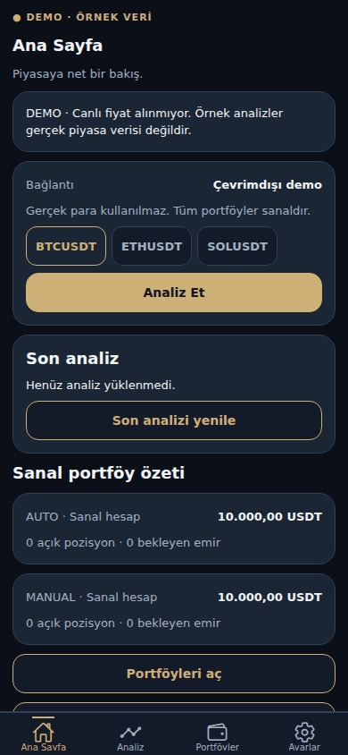
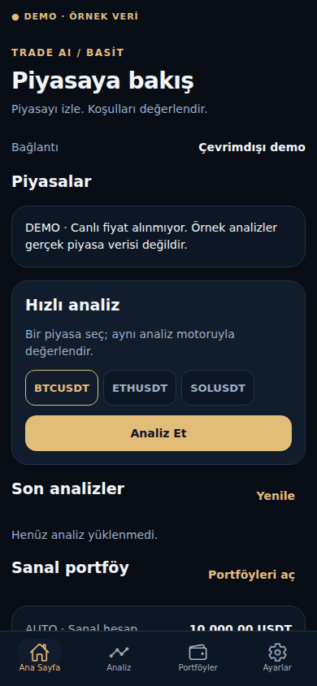
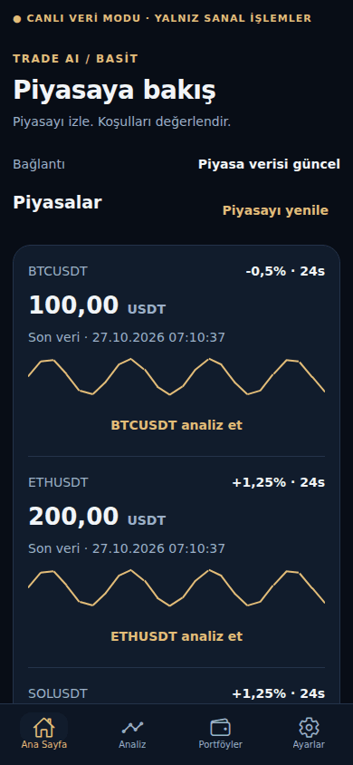
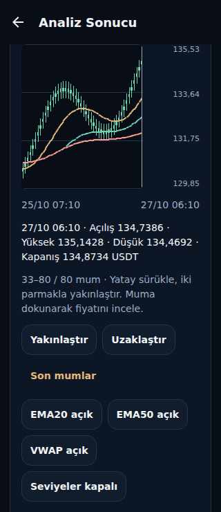
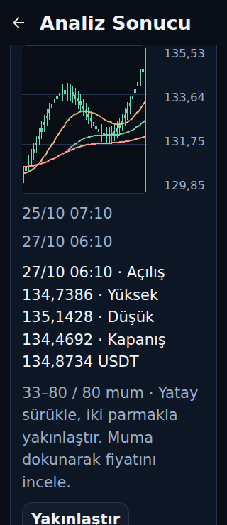

# Görev 7 — Premium mobil arayüz ve grafik sistemi

27 Ekim 2026. Görev 6 kaynakları üzerine geliştirilmiştir; yeniden yazım değildir.
Android test sürümü: **0.6.0 / versionCode 8** (arm64-v8a, internal debug signing).

## Başlangıç doğrulaması

GitHub PR #1 kayıtları, dal HEAD'leri ve `TRADE_AI_2_PRODUCT_ROADMAP.md` okundu.
Geçmiş sohbet özetindeki çelişkili SHA'lar kullanılmadı; GitHub kaynak alındı.

| Depo | Görev 6 geliştirme dalı | Doğrulanan SHA |
| --- | --- | --- |
| Android | codex/android-stability-20261026 | c30e596dcc354a61dcf077d54204d2d1b6e73cb7 |
| Gateway | codex/gateway-continuity-20261026 | 19038bdecd5ef472ff7826bb074208d300d682f8 |
| Backend | codex/v2-mobile-quotes-20261026 | 6b545e72f4439301eda277d4ee789bb94608cdcb |

Görev 6 raporu: Android PR #1 açıklaması. Android 0.5.1 / 7 APK:
https://github.com/FatihBirgul/trade-ai-android/actions/runs/40457097691 .
Bu sürümün kaynağı, dalı ve artifact'ı değiştirilmedi veya silinmedi.
Bu çalışma ortamı boştu; kullanıcının Windows dosyalarına erişilmedi.

Yeni dal: `codex/task7-premium-mobile-20261027`. Main'e push/merge yoktur;
üç PR #1 açık kalır. Backend ve Gateway değişmedi; PC güncellemesi gerektiren
API değişikliği yapılmadı. Görev 6 servisleri ayrıca PC'ye kurulmamışsa fiyat ve
takip için o önceki kurulum gereksinimi devam eder; bu görev servis kurmaz.

## Öncesi → sonrası

| Önce | Sonra |
| --- | --- |
| Benzer altın çerçeveli butonlar | Birincil altın CTA, nötr ikincil buton, çerçevesiz metin aksiyonu |
| Benzer boyuttaki başlık/kartlar | Marka ve Basit/Pro etiketi, belirgin ekran başlığı, bölüm başlığı, kart yüzeyi hiyerarşisi |
| Fiyat başına tekrarlanan açıklama/kart | Bir piyasa paneli; belirgin fiyat/değişim, gerçek mini grafik, kaynak zamanı ve ortak açıklama |
| Ayrı AUTO/MANUAL özet kartları | Ortak panel içinde ayrı hesap satırları; hesap bakiyeleri birleştirilmez |
| Basit sabit ölçekli yatay mum listesi | Sınırlı viewport, yatay sürükleme, iki parmak yakınlaştırma, fiyat/zaman ekseni ve OHLC inceleme |
| Mumlar yalnız teknik detayda | Kısa sonucu bozmayan isteğe bağlı mum paneli; teknik detay da korunur |
| Çizgi kontrolü yok | Pro'da SMA başlangıçlı EMA20/50, snapshot başlangıcından VWAP ve güvenli seviyeler aç/kapat |

Renk, boşluk, tipografi ve köşe token'ları `src/theme.tsx` içindedir.
Harici font/native grafik bağımlılığı veya animasyon eklenmedi. Güvenli alan ve
klavye davranışı korundu; alt gezinme yüksekliği cihaz inset/fontScale'ine uyar.
Küçük ekran/büyük yazıda satırlar ve buton grupları alt alta akabilir.

## Veri doğruluğu ve grafik sınırları

- Fiyatlar mevcut `/api/v2/quotes` sözleşmesinden gelir. BTC/ETH/SOL, 24 saatlik
  değişim ve gerçek kapanmış 1H fiyat noktaları kullanılır. DEMO'da piyasa fiyatı
  gösterilmez. Veri yok/kesinti/bayat/son başarılı kaynak zamanı ayrı gösterilir.
- Bu mini grafik kapanmış 1H noktalarıdır; gerçek zamanlı mum grafiği olarak
  adlandırılmaz. Mevcut odak/ön plan polling ve tek istek sınırları korunur.
- Analiz grafiği yeni piyasa isteği değildir. Kayıt yükleme isteğe bağlıdır;
  analysis_id, as_of, timeframe, piyasa, provider, venue ve snapshot_only doğrulanır.
  Başka analizin veya oturumun verisi çizilmez.
- Grafikte `KAYITLI ANALİZ · CANLI GRAFİK DEĞİL` ve analiz zamanı görünür.
  Kayıtlı mumlar/karar/girdiler değiştirilmez. Basit ve Pro aynı kaydı kullanır.
- Fiyatlar/kapalı mumlar/sıralama kontrol edilir. En çok 4096 giriş kabul edilir;
  daha büyük kayıt sessizce kırpılmaz. Ekranda en fazla 96 mum çizilir; mevcut
  istemci normalde 80 mum ister. Veri ve gösterge hesapları memoize edilir.
- Yakınlaştırma 12–96 görünür mum arasındadır (kısa kayıtta mevcut sayı).
  Dikey kaydırma ebeveyn sayfaya bırakılır. İki parmak yakınlaştırma ve yatay
  hareketler PanResponder ile; ayrıca erişilebilir yakınlaştırma butonları vardır.
- EMA20/50 yalnız yeterli geçmiş varsa açılır. İlk değer ilgili dönemin basit
  ortalamasıdır. Motorun daha uzun geçmişle hesapladığı son EMA ile birebir
  eşitlik iddia edilmez. Çizgi hesabı analiz isteğine veya kararına girmez.
- VWAP yalnız gerçek ve geçerli hacimle hesaplanır; kaydın ilk mumunda başlar.
  Seans/gün başlangıcı VWAP'ı değildir. Eksik hacim veya tümü sıfır hacimde
  kullanılamayan kontrol kapanır. Bu kapsam açıklaması Pro panelinde görünür.
- Giriş/geçersizlik/TP1/TP2 yalnız mevcut safeDecision kontrolü geçerse Pro'ya
  aktarılır. BEKLE veya süresi dolmuş kayıtta aktif seviyeler açılmaz.
  Gösterge/level kontrolü değişince analiz yeniden hesaplanmaz.
- Eksen rakamları büyük yazıda kısa gösterilir; ayrıntılı OHLC bilgisi altta korunur.
- Performans geçmişi yokken grafik veya tahmini getiri üretilmez. Portföyler
  salt okunur kalır. Gerçek para ve doğrulanmamış sanal emir yazmaları kapalıdır.

## Doğrulama

- Yerel TypeScript ve ESLint: başarılı, uyarı yok.
- Jest: **99 test / 25 suite başarılı** (Görev 6: 90 test / 23 suite).
  Yeni testler bozuk/sırasız/aşırı mum, EMA warmup/VWAP, bounded pan/pinch,
  native gesture callback'leri, Basit/Pro kontrolleri, snapshot kimlik reddi,
  boş piyasa ve kesintide bayat veri görünümünü kapsar.
- 17 ağsız Expo SDK/lock/config kontrolü ve Android Metro export: başarılı.
  Online Expo Doctor çalıştırılmadı. Paketlerin sürümleri/dependency listesi aynı;
  yalnız uygulama sürüm bilgisi artırıldı.
- Android CI: her kaynak checkpoint'inde frontend kontrolleri çalıştırıldı.
  Bunlar TypeScript, ESLint, Jest, ağsız doctor ve Android export içerir.
- GitHub tree karşılaştırması: API istemcileri/schema, state, quote polling,
  safeDecision, snapshot doğrulaması dahil **15 korunan kaynağın blob SHA'ları
  Görev 6 ile aynıdır**. Yenileme/scanner recovery/follow güvenlik yolları korunur.
- Gerçek export edilmiş React Native Web uygulaması Chromium'da açıldı.
  Kontrollü HTTP fixture'larıyla 7 senaryo: DEMO, fiyat, kesinti/bayatlık,
  Basit grafik, Pro grafik, 320px, 320px + %150 tarayıcı metni. JavaScript hatası
  ve document seviyesinde yatay taşma görülmedi; PNG'ler görsel olarak incelendi.
  Native fontScale için mevcut 320px/%150 satır testleri de geçti.
- Web kontrolü sentetik veridir; gerçek Binance/backend/Windows/telefon
  entegrasyon testi veya Android performans ölçümü değildir. Fixture'lar yalnız
  QA script'indedir; üretim uygulamasına eklenmedi.

Tekrarlanabilir görsel kontrol: önce `EXPO_OFFLINE=1 npx expo export --platform web
--output-dir /tmp/trade7-web`, sonra repo kökünden `node scripts/visual-qa.cjs`.
Haricen kurulu Playwright ve Chromium gerekir; gerekirse `PLAYWRIGHT_MODULE`,
`CHROMIUM_EXECUTABLE`, `WEB_EXPORT_DIR`, `VISUAL_OUTPUT_DIR` ayarlanır.
Script yalnız kendi geçici HTTP sunucusunu ve route fixture'larını kullanır.

## Görsel kanıt

İlk iki görsel gerçek DEMO ekranlarının önce/sonrasıdır. Diğerleri kontrollü QA
verisidir; gerçek piyasa fiyatı veya canlı servis doğrulaması olarak kullanılmaz.

| Önce (0.5.1) | Sonra (0.6.0) |
| --- | --- |
|  |  |

## Gerçek cihazda bekleyenler

- 0.5.1 üzerine güncelleme, açılış, Android fontScale ve gezinme/klavye kontrolleri.
- İki parmak pinch + dikey sayfa kaydırma çakışması, TalkBack ve eski telefonda
  kaydırma akıcılığı/ısı/bellek/FPS ölçümü. Otomatik callback testleri fiziksel
  dokunmatik testinin yerine geçmez.
- Kullanıcının özel ağı ve çalışan Görev 6 servisleriyle gerçek fiyat,
  oturum yenileme, scanner recovery ve takip başlat/durdur/devam regresyonları.
- Arka plan/ön plan dönüşü ve bağlantı kesilmesinde gerçek cihaz davranışı.
- PC kurulumu veya canlı cihaz testi burada yapılmadı; kullanıcının Windows
  servislerine/veritabanlarına/firewall/Tailscale ayarlarına dokunulmadı.

## Checkpoint ve CI bağlantıları

| Checkpoint | SHA | Android frontend CI |
| --- | --- | --- |
| Tasarım ve ana sayfa | d6692b4c623434d5853dcd64b1ef00b9faa2f6bd | https://github.com/FatihBirgul/trade-ai-android/actions/runs/40464006922 |
| Immutable grafik | 9c62cfa942e36e7cd94a7f0b741ba95bab06cd5b | https://github.com/FatihBirgul/trade-ai-android/actions/runs/40464510631 |
| 0.6.0 düzenleri | 53d72568376d02a398848757792f291f1fb0bade | https://github.com/FatihBirgul/trade-ai-android/actions/runs/40465050504 |
| Son uygulama kaynağı | 92a0bfbfac3bf5847e6a6693dc51f6dcd2a57de8 | https://github.com/FatihBirgul/trade-ai-android/actions/runs/40465585245 |

APK derleme ve artifact sayfası:
https://github.com/FatihBirgul/trade-ai-android/actions/runs/40465585289 .
Bu run `92a0bfb` kaynağını kullanır; dokümantasyon commit'leri APK kaynağını
ve uygulama davranışını değiştirmez. Artifact içindeki `BUILD_INFO.txt`, sürüm,
package, kaynak SHA ve APK SHA-256 bilgilerini içerir. Derleme işinde imza ve
embedded Metro bundle doğrulaması vardır. Final durum run sayfasından doğrulanır.
İç test sürümü üretim sürümünün yerini almak için otomatik dağıtılmaz.

Ayrı inceleme PR'ı: https://github.com/FatihBirgul/trade-ai-android/pull/2 .
Hedefi Görev 6 geliştirme dalıdır; main ve PR #1 birleştirilmez.

## Son APK doğrulaması — başarılı

Native CI run **40465585289** başarıyla tamamlandı. Kaynak: `92a0bfb`.
Artifact: https://github.com/FatihBirgul/trade-ai-android/actions/runs/40465585289/artifacts/12717780072 .

- Android **0.6.0 / versionCode 8**, `com.fatihbirgul.tradeai`, arm64-v8a.
- APK boyutu: **37.464.773 bayt**.
- APK SHA-256: `21d7d4f0f89b64f402715b2c7fdf7bebd84d172b1942a1022dc59a968819b48e`.
- Artifact ZIP SHA-256: `52e67f5413a73f8f285ec9b5f8f4c3fa31dc787e0dfce1e38f9ce4dcc37c5e0c`.
- CI APK Signature Scheme v2 doğrulaması geçti. Sertifika SHA-256:
  `fac61745dc0903786fb9ede62a962b399f7348f0bb6f899b8332667591033b9c`;
  Görev 6 raporundaki 0.5.1 imzasıyla aynıdır. Fiziksel güncelleme henüz denenmedi.
- Artifact ayrıca indirildi; ZIP SHA-256/CRC, APK SHA-256–BUILD_INFO eşitliği ve
  APK içindeki embedded `index.android.bundle` bağımsız olarak kontrol edildi.
- Eski 0.5.1 dosyasına dokunulmadan ayrı **Trade-AI-0.6.0-test.apk** oluşturuldu.

[Trade-AI-0.6.0-test.apk](https://chatgpt.com/library?file_id=libfile_c910894fd3588191915550d15e517b4a&account_id=personal)

Son dokümantasyon checkpoint'leri uygulama kaynağına veya APK'ya değişiklik
getirmez. Başlangıçtaki Görev 6 dalları ve üç PR #1 tekrar doğrulandı; aynı
SHA'larda ve açık/birleştirilmemiş durumdadır.
