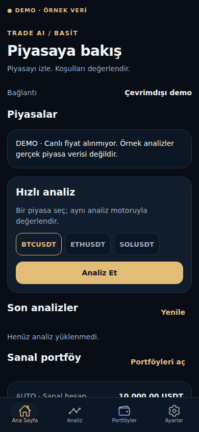
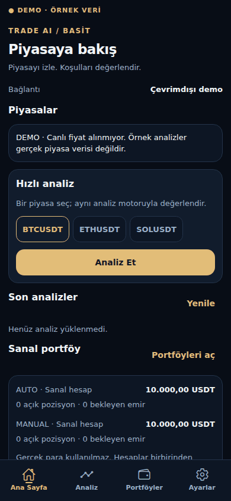
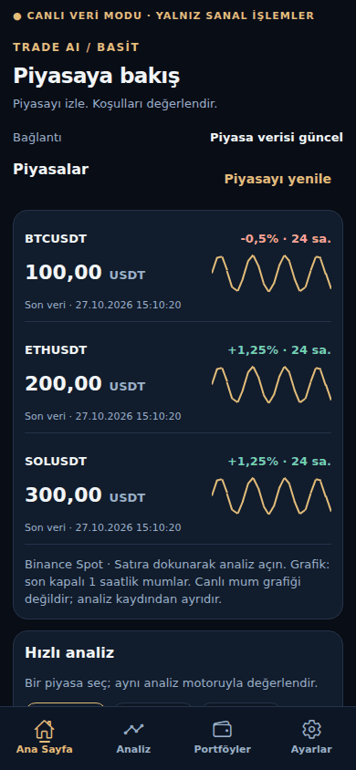
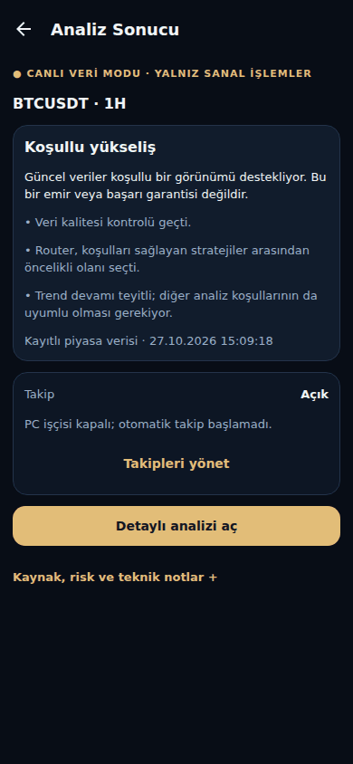
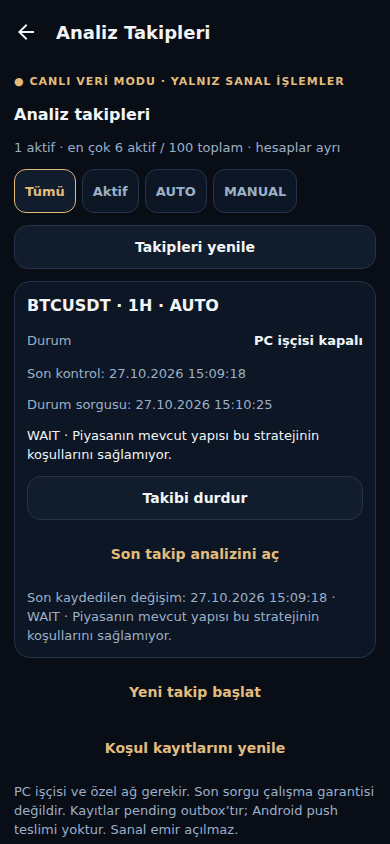
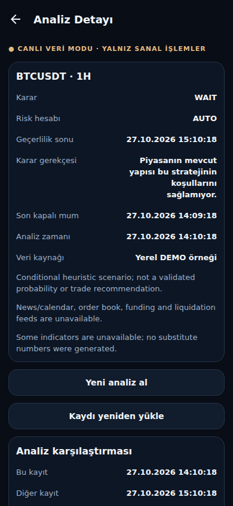
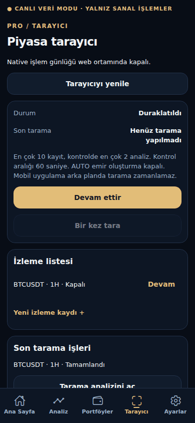
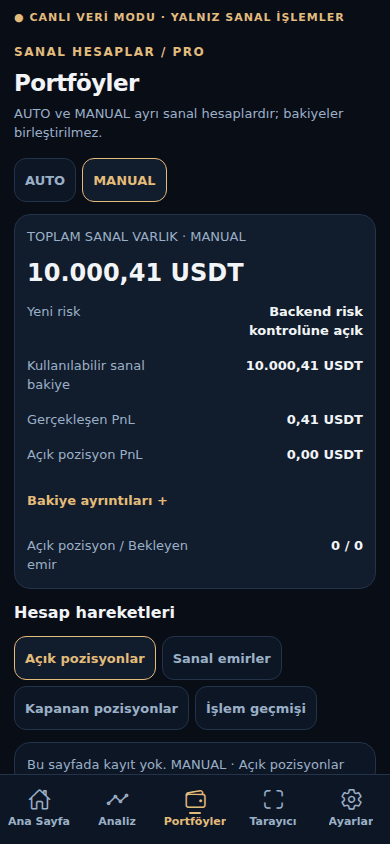
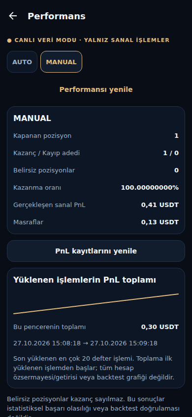
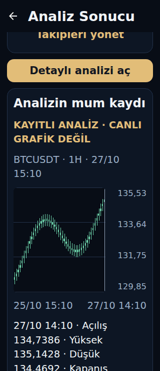

# Görev 8 — Android 0.7.0 / versionCode 9

27 Ekim 2026. Görev 7'nin üzerine geliştirilmiştir. Bu belge kaynak düzeltmeleri,
işlevler, doğrulama kanıtı, sınırlar ve güvenli geçiş içindir. Yeni sürüm henüz
kullanıcının telefonunda veya emülatörde çalıştırılmadı. Web görünümü bu testin
karşılığı değildir.

## 1. Korunan başlangıç ve çalışma dalı

Başlangıçta GitHub'daki gerçek PR/dal HEAD'leri, Görev 6/7 teslim açıklamaları,
`TRADE_AI_2_PRODUCT_ROADMAP.md`, `TASK7_PREMIUM_MOBILE.md` ve backend
`docs/V2_ANALYSIS_FOLLOW.md` okundu. Backend `AGENTS.md` kuralları da okundu.

| Depo | Korunan referans |
| --- | --- |
| Android Görev 7 | `eba362bcfca0b99c1276fab72780e420f6904e66` |
| Görev 7 APK kaynağı | `92a0bfbfac3bf5847e6a6693dc51f6dcd2a57de8` |
| Gateway | `19038bdecd5ef472ff7826bb074208d300d682f8` |
| Backend | `6b545e72f4439301eda277d4ee789bb94608cdcb` |

Yeni dal: `codex/task8-native-reliability-20261027`; doğrudan Görev 7 HEAD'inden.
Main, Görev 6/7 dalları, PR #1/#2 ve eski APK dosyaları değiştirilmez.
Backend/Gateway kaynakları bu görevde salt okunurdur; yeni endpoint, DB şeması,
provider veya PC servisi kurulmadı. Analiz algoritması değiştirilmedi.

## 2. Telefon hataları: bulgu ve uygulanan kaynak düzeltmesi

| Bildirilen hata | İnceleme ve düzeltme |
| --- | --- |
| Alt ikonlar nokta/çizgi | 0.6.0 APK içindeki `res/CU.ttf`, kurulu Ionicons dosyasıyla SHA-256 olarak aynıdır: fontun APK'da bulunmadığı varsayımı doğrulanmadı. Eski otomatik boyutlanan ikon kabında 28px yatay padding, navigatörün 31px yuvasında çok dar glyph alanı bırakabilir. Padding kaldırıldı; ikon yuvası 32×28, glyph 23px ve yazı ölçeğinden bağımsızdır. Başlangıç `useFonts(Ionicons.font)` ile açıkça bekler; hata sonsuz boş ekran yerine gösterilir. |
| Durum çubuğunun arkasına kayan içerik | Safe-area üst boşluğu ScrollView'ın **içindeydi**; içerikle birlikte kayboluyordu. Artık ScrollView dışında sabit SafeAreaView vardır. Sekmeler üst insett'i; başlıklı stack ekranları yalnız alt insett'i sahiplenir. Root SafeAreaProvider/initialWindowMetrics, temayla uyumlu StatusBar ve root pencere rengi kullanılır. Rastgele ek üst padding yapılmadı. |
| Fazla büyük kart/başlık/boşluk | Başlık 28→23, bölüm 19→16, gövde 14→13; aralık/kart boşlukları azaltıldı. Üç fiyat satırı tek kompakt panelde, küçük grafik yanında görünür. Teknik açıklamalar öncelikli işlemleri aşağı itmez. |
| Alt menü ve etiket kesilmesi | QA'da navigasyon bileşeninin kendi 5+5px iç boşluğu da saptandı. Yükseklik glyph + ölçeklenen etiket + iç boşluk + sistem insett'i üzerinden hesaplanır; web'de etiket sınırları otomatik kontrol edilir. Basic/Pro geçişinde geri hedefi ilk görünür Ana Sayfa'dır; gizli Tarayıcı geçmişine dönülmez. |

Bunlar kaynak/audit ve otomatik test bulgularıdır. Yeni APK'da gerçek Android
çizimi, fontScale, kaydırma ve sistem navigation bar davranışı kullanıcı cihazında
ayrıca onaylanmalıdır.

## 3. Sonuç ve takip yönetimi

- Basit sonuç: piyasa/zaman dilimi, aynı immutable karar, Türkçe açıklama, en çok
  üç dayanak, veri zamanı, kısa takip durumu, doğrudan detay butonu. Dayanaklar
  seçilen strateji/Router içindir; ilgisiz reddedilen kurulumlar ana kararın
  gerekçesi gibi gösterilmez.
- DEMO'da büyük pasif takip kartı yoktur. Kaynak/risk/strateji notları kapalı
  disclosure içindedir. Pro'da kayıtlı mumlara ve teknik ayrıntılara erişim korunur.
- Yeni `/follows` ekranı aktif/duraklamış takipleri birlikte gösterir; sembol,
  zaman dilimi, hesap, son kontrol/sorgu, durum ve PC işçisi bilgisi vardır.
- Başlat/durdur/devam ve son immutable analizi aç çalışır. Sonuç ekranından
  yönetim ekranına geçiş **aynı analysis_id** ile yapılır; başka son kayıt seçilmez.
- Yetki/hesap doğrulanır; yanlış hesaptan gelen takip listesi gösterilmez.
  Hızlı çift dokunma kilitlidir. Belirsiz POST sonrası GET ile uzlaştırılır;
  otomatik ikinci POST gönderilmez.
- Son anlamlı koşul değişikliği mevcut outbox'tan tracking_id + hesap eşleşmesiyle
  bulunur. En fazla beş sayfa/100 bildirim okunur; eski kayıt bu pencerede yoksa
  bu açıkça belirtilir. Güncel son değerlendirmeyle eski anlamlı değişim karışmaz.
- Bağlantı hatası olduğunda işçinin çalıştığı iddia edilmez. Çalışıyor yanıtı dahi
  son sorguya aittir. Pending outbox, Android push olarak sunulmaz.
- Mevcut tek aktif piyasa/zaman/hesap, altı aktif/100 toplam, iki analiz/dakika,
  stale/backoff, dedup ve hesap izolasyonu backend'de aynen korunmuştur.

## 4. Piyasa ve bağlantı dayanıklılığı

- BTC/ETH/SOL mevcut fiyat ve kapalı 1H geçmişiyle gösterilir. Satırın tamamından
  analize geçilir; 24 saat değişimi ve kaynak zamanı görünür. Sahte fiyat yoktur.
- Kesintide aynı bağlantının son başarılı fiyatı/tarihi korunur ve bayat işaretlenir.
  Ön plan/arka plan geçişleri tekrar kontrol edilir; arka planda quote polling yoktur.
- Aynı API örneğindeki aynı GET yolu tek uçuşta birleştirilir; tamamlandıktan
  sonraki yenileme yeni HTTP isteğidir. POST'lar birleştirilmez/tekrarlanmaz.
- Kayıtlı bağlantı native açılışta kontrollü doğrulanır; **DEMO kendiliğinden CANLI
  olmaz**. Kullanıcı yalnız doğrulama sonrası CANLI seçebilir.
- Durumlar: kayıt yok / kontrol ediliyor / hazır / çevrimdışı / oturum reddedildi.
  Son başarılı doğrulama zamanı saklanır; bu, oturum veya fiyat zamanı değildir.
- Başlangıç kontrolü sürerken ön plan olayı ikinci kontrol başlatmaz. Eski oturumun
  geç 401 yanıtı yeni doğrulanmış bağlantıyı bozamaz; bağlantı uçuşu scope'ludur.
- Çevrimdışı kayıtlı bağlantı ön planda 15/30/60/120/240/300 saniye sınırlarıyla
  tekrar doğrulanır. Arka planda yeni deneme yapılmaz; dönüşte kontrollü sorgulanır.
  Reddedilen oturum otomatik denenmez; yeniden eşleştirme açıklanır.
- Token rotasyonu, absolute 30 gün, 24 saat erişim, successor journal, revocation,
  grant/scope ve idempotency protokolleri değiştirilmedi. Son doğrulama tarihi
  30 günlük aile süresini uzatmaz. Hesap/origin/oturum değişince eski veri maskelenir.

## 5. Geçmiş, karşılaştırma ve scanner

- BTC/ETH/SOL, zaman dilimi, AUTO/MANUAL, kaydedilen doğrulanmış karar ve tarih
  sırası filtreleri kapalı bir alandadır. Filtreler yüklenen kayıtlar için çalışır.
- Geçmiş 20'lik server sayfalarıyla kullanıcı isteği üzerine büyür; 400 kayıt
  sınırı ve ekranda en çok 20 eşleşme vardır. Liste tüm geçmişi içeriyormuş gibi
  sunulmaz. Hesap filtresi yüzünden kısa sayfa gelebileceği de gözetilir.
- Karşılaştırma aynı piyasa, zaman dilimi, hesap, mod, provider/venue ve sözleşme
  türünü gerektirir. Karar, rejim, strateji, gerekçe ve RSI/MACD/EMA değerleri
  yan yana okunur. Immutable kayıtlar ve analiz motoru değiştirilmez.
- Scanner duraklatılmış / son sorguda sunucuda iş görülüyor / aktif iş yok /
  bağlantı yok olarak ayrılır. İzinli mevcut izlemeler kısa aksiyonlarla yönetilir.
  Yeni kayıt kontrolleri açılır alandadır; son işler önce beş, istenirse 20 görünür.
- Kalıcı scanner journal, tek POST, timeout ve salt okunur recovery korunur.
  Mobil arka plan taraması veya PC otomasyonunun açık olduğu iddia edilmez.
  Yeni PC scheduler/worker kurulmadı; AUTO auto_paper açılmadı.

## 6. Portföy ve performans

- Bakiye/kullanılabilir tutar/PnL ayrı hesaplarda kompakt gösterilir. Rezerv,
  nakit ve günlük zarar ayrıntıları Pro'da açılır alan içindedir.
- Hesap/mode, sonlu decimal, negatif nakit ve sayaç doğrulaması eklendi.
  Yanlış hesabın defter satırları reddedilir. Sayfalama hesabın/oturumun/sekmenin
  değişiminde anında sıfırlanır; eski cevap yeni hesaba yazılamaz.
- Ek gerçek hata: backend açık pozisyonu pozitif miktarla tanımlarken Android
  yalnız status=open seçiyordu. Açık miktarlı **ambiguous** pozisyonlar artık
  gizlenmez; belirsiz olarak görünür ve kazanç sayılmaz.
- Yenilemede aynı hesaba ait son bakiye tutulabilir; hata/bayatlık ve son sorgu
  zamanı görünür. Yeni hesap/bağlantıya eski hesap verisi taşınmaz.
- Pro PnL grafiği yalnız aynı hesabın en az iki gerçek defter kaydı varsa çizilir.
  Son yüklenen en çok 20 işlemin gerçekleşen PnL'si, 8 ondalıklı tam sayı hesabıyla
  toplanır. Pencere başlangıcı/sonu açıklanır; hesap özsermayesi veya tüm geçmişin
  getirisi/backtest/başarı olasılığı değildir. Veri yoksa örnek eğri üretilmez.
- Gerçek para, sanal oluştur/iptal/kapat ve AUTO otomatik emir kilitleri kapalıdır.

## 7. Checkpoint ve test kanıtları

| Aşama | SHA | İlgili doğrulama |
| --- | --- | --- |
| 1. Native ikon/sistem çubukları | f676ad1eff01b88a46bfebcc216aa9cbd69d303f | 100 Jest; Gateway 42; backend baseline 220 unittest + 2 quote pytest |
| 2. Kısa sonuç | 8a499da5dab8fc0b4d0de1e084cc67b356d7eaa0 | 101 Jest; 5 narrative testi |
| 3. Takip yönetimi | 901a6acf63ff4771b826bf197bc5416b27aa7f73 | 105 Jest; 9 gerçek V2 takip testi |
| 4. Bağlantı/piyasalar | 6fdd6449218f3064810096054d2e1efe17621aa8 | 110 Jest; 32 Gateway güvenlik/yenileme testi |
| 5. Geçmiş/scanner | 687d17e8a92fbc9c78901257e9ea05a707420bbf | 113 Jest; 31 scanner/recovery/record-store testi |
| 6. Portföy/0.7.0 | 07b4de832983e704648621530fc2eeb9c27d6926 | 117 Jest; 52 paper-risk/product API testi |
| Son görsel/başlangıç QA | e5f82df48ab3f71d62232650dd7afc8129e33f47 | 122 Jest; font bariyeri, ölçülen nav, pinned analysis, startup guard |
| Native geri hedefi | 2bf00177b1d08968caaa6279d06d23f2c8314743 | 123 Jest / 33 suite; Basic/Pro sonrası Ana Sayfa |
| Son uygulama kaynağı | 5b9421d46564de3a5351820bf213f267f7284080 | **124 Jest / 33 suite**; seçilen stratejiye ait kısa gerekçeler; 13 görsel senaryo |

- TypeScript/ESLint başarılı; 17 ağsız Expo SDK/lock kontrolü ve Android/Web
  export başarılı. Online Expo Doctor çalıştırılmadı. Yeni native bağımlılık yok.
- Gateway **42 pytest** geçti; sekiz gerçek V2/geçici DB entegrasyonu dahil.
- Backend **220 offline unittest + iki quote pytest** geçti. Hedefli Python
  sayıları aynı baseline ile örtüşür; bunlar toplanarak yeni toplam üretilmez.
  Starlette/AnyIO tarafında mevcut deprecation uyarısı gözlendi; testler geçti.
- Üretim Android API modülleri → CA doğrulanan yerel TLS → Gateway → gerçek V2
  zinciri geçti: analiz/MTF/snapshot, scanner/outbox, yenileme/journal recovery ve
  varsayılan paper kilidi. Kontrollü sentetik sağlayıcı ve geçici DB kullanıldı;
  kullanıcı servisi, gerçek para, borsa veya fiziksel telefon testi değildir.
- 13 gerçek export edilmiş web UI senaryosu Chromium'da geçti; JavaScript hatası
  ve document seviyesinde yatay taşma yok. Tab etiketi sınırları ayrıca denetlendi.
  320px ve %150 tarayıcı metni kontrol edildi; bu, native fontScale testi değildir.
- `scripts/verify-apk.py` release APK'daki gerçek Ionicons bytes, embedded JS ve
  ZIP CRC'yi denetler; native derleme hattına eklendi. Bu audit cihazda glyph
  çizildiği anlamına gelmez. 0.6.0 APK üzerinde audit ayrıca yerelde geçti.

Tekrarlama: `npm run typecheck`, `npm run lint`, `npm test`, `npm run doctor:local`;
`EXPO_OFFLINE=1 npx expo export --platform web --output-dir /tmp/trade8-web` sonrası
repo kökünden `node scripts/visual-task8.cjs`. Haricen Playwright/Chromium gerekir;
`CHROMIUM_EXECUTABLE` gerekirse ayarlanır. Sonuç JSON'u `docs/task8/visual-results.json`.

## 8. Görseller

| 0.6.0 DEMO web görünümü | 0.7.0 DEMO web görünümü |
| --- | --- |
|  |  |

Bu karşılaştırma yerleşim yoğunluğunu gösterir; native ikon/status bar onayı değildir.

Aşağıdaki CANLI etiketli görseller **kontrollü HTTP fixture'larıdır**; gerçek
piyasa fiyatı, telefon görüntüsü veya canlı backend kanıtı değildir. Test fixture
verileri üretim ekranlarına kaynak olarak eklenmedi.

## 9. Gerçek cihaz ve tamamlanmayan doğrulamalar

- Bu çalışma ortamında adb/emulator/sdkmanager yoktur. Native/emülatör UI testi
  yapılmadı. CI assembleRelease ve asset/imza audit'i bunun yerine sayılmaz.
- 0.6.0 üzerine güncelleme, açılış, beş ikonun gerçek çizimi, fontScale,
  durum çubuğuna kaydırma, gesture/üç düğmeli sistem navigation bar testleri bekler.
- Native pinch/scroll/TalkBack, eski cihaz FPS/bellek/ısı ve uzun süreli çalışma
  ölçülmedi. Viewport/liste sınırları uygulanmış olsa da akıcılık garantisi verilmez.
- Kullanıcının özel ağı ve Windows'uyla gerçek yeniden bağlantı, 24 saat erişim /
  30 gün mutlak yenileme, iptal, takip açık/kapalı işçi ve scanner recovery testleri
  bekler. Otomatik testler gerçek zamanlı 30 gün bekleme yerine geçmez.
- Push teslim altyapısı, sınırsız geçmiş/outbox araması ve tüm hesabın tarihsel
  equity grafiği eklenmedi. Bu görevde sanal/gerçek emir yazmaları açılmadı.

## 10. PC'deki mevcut sistemden güvenli geçiş

1. Eski 0.6.0 APK'yı saklayın. Yeni APK ayrı iç test sürümüdür; uygulama verilerini
   silme veya kaldırıp yeniden kurma adımı önerilmez. Aynı paket/imza doğrulandıktan
   sonra normal Android güncellemesi kullanıcı cihazında denenmelidir.
2. Görev 6 Backend/Gateway PC'de zaten kuruluysa **Görev 8 için PC kaynak/DB/servis
   güncellemesi gerekmez**. Bu görev API sözleşmesini ve Python kaynaklarını değiştirmedi.
3. Açılış DEMO'dur. Kayıtlı bağlantının durumunu görün; doğrulandıktan sonra CANLI
   seçin. Yenileme mutlak 30 günü uzatmaz. İptal/süre sonu veya eski yenilemesiz
   oturumda yerel eşleştirme için PC erişimi gerekebilir; gizli backend tokenını
   telefona girmeyin.
4. Piyasalar, aynı analiz, takip listesi/işçi durumu, scanner durumu ve iki ayrı
   hesabı sırasıyla kontrol edin. İşçi kapalıysa takip kaydı var diye otomasyon
   başlamaz. Outbox push değildir.
5. PC hâlâ Görev 6 öncesindeyse mevcut DB/env/token/ACL'leri koruyarak tutarlı
   yedek alın ve yalnız mevcut Görev 6 kılavuzuna göre bilinçli güncelleyin.
   `docs/V2_ANALYSIS_FOLLOW.md` içindeki opt-in `--tracking` gerekebilir.
   Burada servis başlatılmadı/değiştirilmedi. AUTO otomasyonu veya `--scanner`
   açılması bu teslimin geçiş adımı değildir.
6. Funnel, public port, firewall/Windows execution policy değişikliği, DB reset,
   main/PR merge veya paper-write kilidi kaldırma gerekmiyor.

## 11. Son kaynak CI ve APK kanalı

Son uygulama kaynağı: `5b9421d46564de3a5351820bf213f267f7284080`.
Frontend CI başarılı:
https://github.com/FatihBirgul/trade-ai-android/actions/runs/40518709640 .
Son APK derleme/doğrulama kanalı:
https://github.com/FatihBirgul/trade-ai-android/actions/runs/40518709816 .

Ara adayların APK işleri, daha sonraki doğrulanmış kaynak tarafından iptal
edilebilir; teslim APK'sı yalnız yukarıdaki son kaynağa bağlanır. Sonraki belge/
görsel commit'leri uygulama davranışını değiştirmez. Doğrulanmış artifact/hash/imza
bilgileri bölüm 12’dedir.

GitHub tree kontrolünde Task 7'ye göre rotasyon, scanner journal, native intent,
paper safety, secure random, safeDecision, snapshot ve OpenAPI/schema doğrulaması
dahil on korunan kaynağın blob SHA'ları aynıdır. Üretim app/src dosyalarının
secret-pattern taramasında eşleşme görülmedi.

## 12. Doğrulanmış APK teslimi

- **0.7.0 / versionCode 9**, `com.fatihbirgul.tradeai`, arm64-v8a iç test APK'sı.
  Paket/sürüm ayrıca indirilen APK'nın binary AndroidManifest.xml dosyasından okundu.
- APK kaynak commit'i: `5b9421d46564de3a5351820bf213f267f7284080`.
- [APK CI başarılı](https://github.com/FatihBirgul/trade-ai-android/actions/runs/40518709816):
  assembleRelease, testler, font-byte/embedded JS/CRC, apksigner ve artifact upload geçti.
- [Artifact 12742970172](https://github.com/FatihBirgul/trade-ai-android/actions/runs/40518709816/artifacts/12742970172),
  `trade-ai-internal-apk`, ZIP 20.103.759 byte. GitHub saklama sonu: 3 Kasım 2026.
- [Trade-AI-0.7.0-test.apk](https://chatgpt.com/library?file_id=libfile_5da75c2823548191a986192707f81447&account_id=personal),
  **37.503.457 byte**. Eski 0.6.0 APK ayrı dosya olarak korundu.
- APK SHA-256: `fc8b0d0d6303461c001850375c7a51ac7da45b48b6d11be48efab77635c4b8d1`.
- Artifact ZIP SHA-256: `ac58e84d58b1d9a409b55305e4cc6e85630c146f87ba3efee2f2cb775017d259`.
  İndirilen ZIP özeti GitHub digest'iyle; APK özeti BUILD_INFO.txt ile eşleşti.
- CI apksigner sertifika SHA-256:
  `fac61745dc0903786fb9ede62a962b399f7348f0bb6f899b8332667591033b9c`.
  **0.6.0 ile aynı sertifikadır**. Yeni APK'nın font bytes, embedded JS ve ZIP CRC
  kontrolleri yerelde de geçti. Bu iç test sürümünde generated debug signing kullanılır.
- [Ayrı taslak PR #3](https://github.com/FatihBirgul/trade-ai-android/pull/3)
  Görev 7 geliştirme dalını hedefler; PR #1/#2 birleştirilmedi.

Son GitHub kontrolünde korunan dört PR açık ve unmerged; Android Görev 7,
Gateway ve Backend HEAD'leri bölüm 1'deki referanslarla aynıdır. Uygulama kaynağı
sonrası commit'ler yalnız belgeleri/görselleri değiştirir. Fiziksel telefon testi
bölüm 9'da hâlâ bekleyen iş olarak tutulmuştur.
