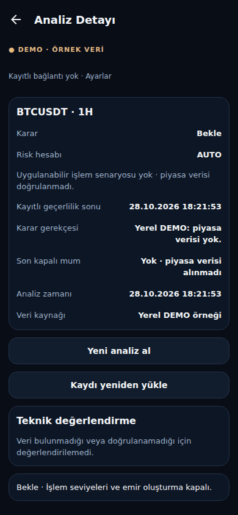
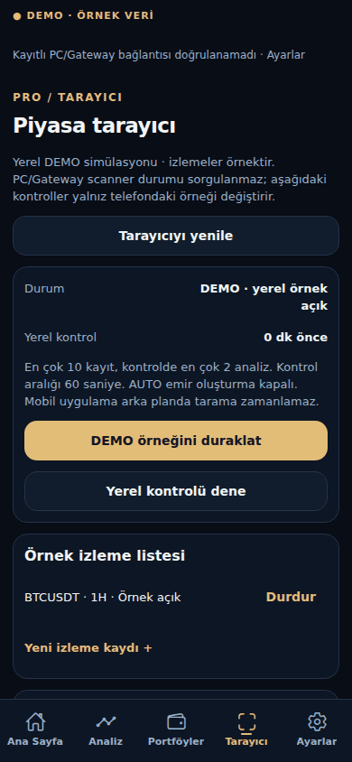
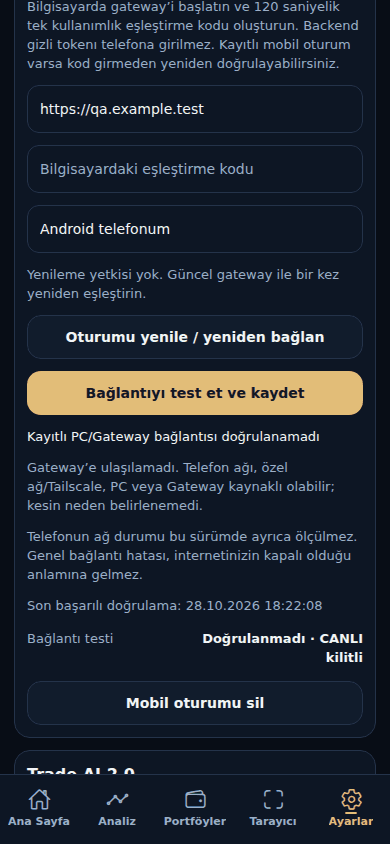

# Görev 9 — Android 0.7.1 / versionCode 10

28 Ekim 2026. Android geliştiricisi: GPT Work. Bu teslim yalnız Android deposundadır.

## 1. Gerçek cihaz bulguları

Kullanıcı 28 Ekim'de 0.7.0'ı DEMO modunda denedi: açılış, düzgün ikonlar,
okunur başlıklar, Ana Sayfa/Analiz/Sonuç/Detay/Portföy/Ayarlar/Bildirimler,
Basit/Pro, Pro Tarayıcı ve kaydırma olumlu bildirildi. Bu oturumda görüntüler
**ekli değildi**; kullanıcı gözlemleri kaynak alındı, görüntüler görülmüş sayılmadı.
Canlı piyasa/PC bağlantısı/gerçek scanner ve takip worker başarısı doğrulanmadı.

Kaynakta doğrulanan nedenler ve kapsam:

| Bulgu | Kaynak nedeni | Düzeltme türü |
| --- | --- | --- |
| Tekrarlayan kırmızı bağlantı uyarısı | Page her ekrana connectionError basıyordu | Ortak kompakt durum ve Ayarlar ayrıntısı; UX + doğru neden sunumu |
| Ağınızı kontrol edin | NETWORK bilinmeyen fetch nedenini telefon ağına bağlıyordu | Neden uydurmayan erişim hatası |
| DEMO sunucu durumu gibi görünüyordu | Yerel boş listeler ve örnek scanner/bakiye metinleri gerçek endpoint sonucu gibi adlandırılmıştı | Veri kaynağı/başarılı boş/hata ayrımı |
| range / wait / neutral | demoAnalysis, wait.json'daki rejim/MTF'yi miras alıyordu; detay ham alanları gösteriyordu | Doğrulanmamış değerlendirmenin sunumunu engelleme |
| Eşit analiz/bitiş zamanı | Yerel DEMO'nun iki tarihi Date.now ile oluşturuluyor | Zaman değiştirilmedi; uygulanabilir işlem senaryosu yok açıklaması |
| Scanner resume | Duraklatma tercihi worker garantisi değildi | Son sorgu ve yerel simülasyon etiketleri; güncel okuma/çift dokunma kilidi |

0.7.1 bu ortamda gerçek telefon/emülatörde çalıştırılmadı. Yeni kaynak düzeltmeleri
kullanıcının 0.7.0 cihaz gözlemleriyle karıştırılmaz. İkonlar, tab sayısı, safe-area,
ana tema ve grafik sistemi yeniden kurulmadı.

## 2. Yapılan geliştirmeler

- Page kısa bağlantı durumu gösterir ve Ayarlar'a açılır. Ayarlar tam hata,
  son başarılı doğrulama ve mevcut reconnect/pairing işlemlerini korur. Kayıt yok,
  kontrol sürüyor, reddedilmiş/süresi dolmuş oturum, erişimi doğrulanamayan PC/Gateway,
  son kontrolde hazır ve beş dakikadan eski doğrulama ayrı adlandırılır.
- ApiError kodu state içinde sunum amacıyla saklanır. BACKEND_UNAVAILABLE yalnız
  sunucu bu kodu verirse Gateway yanıtladı/backend erişilemedi olarak ayrılır.
  NETWORK; radyo, DNS/TLS, Tailscale, PC ve Gateway arasında kesin neden seçmez.
  İşletim sistemi ağ detektörü **yoktur**; telefonun kesin çevrimdışı olduğu bağımsız
  ölçülmez ve bunun yerine belirsizlik açıklanır. Son doğrulama erişim garantisi değildir.
- LOCAL_PAIR_REQUIRED reddedilmiş/eşleştirme gereken durumdur; otomatik offline
  retry uygulanmaz. Diğer offline durumlarda 15/30/60/120/240/300 saniye, foreground,
  rotation/journal/revocation ve 24h/absolute30g protokolleri korunur. DEMO otomatik
  CANLI olmaz; doğrulanmamış bağlantıda CANLI seçimi kapalıdır.
- DEMO portföy 10.000 USDT'nin yerel örnek olduğunu söyler; backend risk değerlendirme
  iddiası kaldırılır. Ana sayfa kaynağı kısa etiketlerle ayırır; fazladan bağlantı
  satırı ve doğrulama butonu kaldırılır, işlem Ayarlar'dan ulaşılır.
- DEMO bildirimleri sorgulanmaz; yerel örnek yokluğu sunucuda bildirim olmadığı
  anlamına gelmez. Başarılı boş GET için yalnız **bu sayfa** boş denir; başarısız
  GET hata olarak kalır. Performance hatasında başarılı boş kayıt mesajı üretilmez.
- Analiz sunumunda live veri modu + kalite + sonlu pozitif fiyat + geçerli fiyat
  zamanı olmadan rejim/MTF/strateji değerlendirmeleri gösterilmez. Geçerli tarihsel
  range → Yatay piyasa, wait → Bekle, neutral → Nötr çevrilir. Süre sonu tarihsel
  değerlendirmeyi aktif fırsata dönüştürmez. Immutable kimlik/karar/zaman/algoritma
  ve safeDecision değiştirilmedi; yeni geçerlilik süresi üretilmedi.
- DEMO scanner açıkça yerel simülasyondur. Kontroller yalnız yerel örneği değiştirir;
  API çağrısı yapmaz. Gerçek scanner'ın duraklatılması, son işi, izleme ve boş
  listesi yalnız başarılı GET sonucuna dayanır. Resume cevabı worker çalışması
  olarak sunulmaz. Canlı yazmalar için izinli oturum ve başarılı non-stale okuma
  gerekir; loading/error/stale halde kapalıdır. Aynı render içindeki çift dokunma
  kilitlenir. Tek tick, belirsiz POST sonrası journal/reconcile korunur, ikinci
  otomatik POST yoktur. AUTO otomatik emir ve finansal yazmalar kapalıdır.
- Portföy incelemesinde mevcut account/session/mode scope maskesi, eski yanıt reddi,
  stale bakiye/son sorgu zamanı ve açık miktar/bekleyen emir ayrımı korundu. Finansal
  hesaplama yapılmadı. NaN/Infinity/taşan sayı reddi regresyonu genişletildi.

## 3. Değiştirilen dosyalar — tam yerel yollar

Aşağıdaki dosyalar yalnız `FatihBirgul/trade-ai-android` deposundadır. app ekranlarının
bir kısmında değişiklik yalnız ortak bağlantı bileşenine yeni durum aktarımıdır.

- `/workspace/scratch/f33109ff4dce/trade-ai-android/__tests__/connectionPresentation.test.tsx`
- `/workspace/scratch/f33109ff4dce/trade-ai-android/__tests__/connectionReliability.test.tsx`
- `/workspace/scratch/f33109ff4dce/trade-ai-android/__tests__/dashboard.test.tsx`
- `/workspace/scratch/f33109ff4dce/trade-ai-android/__tests__/demoFlow.test.tsx`
- `/workspace/scratch/f33109ff4dce/trade-ai-android/__tests__/portfolioValidation.test.ts`
- `/workspace/scratch/f33109ff4dce/trade-ai-android/__tests__/summaryCompact.test.tsx`
- `/workspace/scratch/f33109ff4dce/trade-ai-android/__tests__/task9DataStates.test.tsx`
- `/workspace/scratch/f33109ff4dce/trade-ai-android/app.json`
- `/workspace/scratch/f33109ff4dce/trade-ai-android/app/(tabs)/analysis.tsx`
- `/workspace/scratch/f33109ff4dce/trade-ai-android/app/(tabs)/index.tsx`
- `/workspace/scratch/f33109ff4dce/trade-ai-android/app/(tabs)/portfolios.tsx`
- `/workspace/scratch/f33109ff4dce/trade-ai-android/app/(tabs)/scanner.tsx`
- `/workspace/scratch/f33109ff4dce/trade-ai-android/app/(tabs)/settings.tsx`
- `/workspace/scratch/f33109ff4dce/trade-ai-android/app/detail.tsx`
- `/workspace/scratch/f33109ff4dce/trade-ai-android/app/follows.tsx`
- `/workspace/scratch/f33109ff4dce/trade-ai-android/app/history.tsx`
- `/workspace/scratch/f33109ff4dce/trade-ai-android/app/notifications.tsx`
- `/workspace/scratch/f33109ff4dce/trade-ai-android/app/performance.tsx`
- `/workspace/scratch/f33109ff4dce/trade-ai-android/app/result.tsx`
- `/workspace/scratch/f33109ff4dce/trade-ai-android/docs/TASK9_ANDROID_RELIABILITY.md`
- `/workspace/scratch/f33109ff4dce/trade-ai-android/docs/task9/screenshots/task9-demo-detail.png`
- `/workspace/scratch/f33109ff4dce/trade-ai-android/docs/task9/screenshots/task9-demo-scanner-unreachable.png`
- `/workspace/scratch/f33109ff4dce/trade-ai-android/docs/task9/screenshots/task9-live-notifications-empty.png`
- `/workspace/scratch/f33109ff4dce/trade-ai-android/docs/task9/screenshots/task9-live-notifications-failed.png`
- `/workspace/scratch/f33109ff4dce/trade-ai-android/docs/task9/screenshots/task9-settings-unreachable.png`
- `/workspace/scratch/f33109ff4dce/trade-ai-android/docs/task9/visual-results.json`
- `/workspace/scratch/f33109ff4dce/trade-ai-android/package-lock.json`
- `/workspace/scratch/f33109ff4dce/trade-ai-android/package.json`
- `/workspace/scratch/f33109ff4dce/trade-ai-android/scripts/visual-task8.cjs`
- `/workspace/scratch/f33109ff4dce/trade-ai-android/scripts/visual-task9.cjs`
- `/workspace/scratch/f33109ff4dce/trade-ai-android/src/api/client.ts`
- `/workspace/scratch/f33109ff4dce/trade-ai-android/src/domain/analysisPresentation.ts`
- `/workspace/scratch/f33109ff4dce/trade-ai-android/src/domain/connection.ts`
- `/workspace/scratch/f33109ff4dce/trade-ai-android/src/domain/presentation.ts`
- `/workspace/scratch/f33109ff4dce/trade-ai-android/src/state.tsx`
- `/workspace/scratch/f33109ff4dce/trade-ai-android/src/ui.tsx`

## 4. Testler

| Doğrulama | Sonuç |
| --- | --- |
| npm run typecheck | Başarılı |
| npm run lint | Başarılı, uyarı yok |
| npm test | 135 test / 35 suite başarılı |
| npm run doctor:local | 17 ağsız SDK/lock/config kontrolü başarılı |
| Android Metro export | Son kaynak GitHub frontend CI'da başarılı |
| Web Metro export | Son 0.7.1 kaynağı yerelde başarılı |
| Exported-web kontrollü QA | 19 senaryo, sıfır JS hatası/document yatay taşma; tab etiket sınırları kontrol edildi |
| Korunan GitHub blob audit'i | 16 kaynak Task8 ile aynı |
| Üretim app/src secret-pattern taraması | 51 dosyada sıfır eşleşme |
| Native UI / emülatör / gerçek PC ağı | Çalıştırılmadı; ortamda adb/emulator/sdkmanager yok |
| Python backend/Gateway | Bu Android görevinde tekrar çalıştırılmadı; kaynakları değiştirilmedi |
| Online Expo Doctor | Çalıştırılmadı; ağsız kontrol kullanıldı |

Yeni regresyonlar; offline kayıtlı gateway/DEMO ve yalnız GET doğrulaması,
belirsiz ağ nedeni, auth/yenileme ve geç eski 401, DEMO kaynağı, eksik analiz ve
immutable zaman/karar, gerçek başarılı boş liste/başarısız GET, scanner yerel kontrol,
çift dokunmada tek POST ve resume/worker ayrımını kapsar. Mevcut hesap değişimi,
scanner recovery, Basit/Pro, glyph/font bariyeri, grafik ve renewal testleri de geçti.
İlk geliştirme denemelerinde test mock/expectation hataları giderildi; bunlar
başarılı koşu sayılmaz. Mevcut npm ortamında http-proxy config uyarısı görüldü;
TypeScript/ESLint/Jest başarısını etkilemedi.

Görsel kontrol tekrar komutları:

```bash
EXPO_OFFLINE=1 npx expo export --platform web --output-dir /tmp/trade9-web
node scripts/visual-task9.cjs
```

Harici Playwright/Chromium gerekir; CHROMIUM_EXECUTABLE ve LD_LIBRARY_PATH ortam
ayarları bu çalıştırma ortamına özeldir. Test yalnız 127.0.0.1 geçici QA sunucusu
ve kontrollü HTTP fixture'ları kullanır; kullanıcı PC servisi değildir. CANLI
etiketli QA görüntüleri **gerçek backend/piyasa/telefon kanıtı değildir**.

[19 senaryo sonucu](task9/visual-results.json)




Başarısız bildirim GET (görsel özgün kaynak deposunda).
Başarılı boş bildirim GET (görsel özgün kaynak deposunda).

## 5. GitHub

Başlangıç Task8 HEAD'i GitHub'da `b2f829bffeaafa6017e0b16d36d2f1a9c9df1318`
olarak doğrulandı; istenen yeni dal önceden yoktu, doğrudan bu commit'ten oluşturuldu.
Dal: `gpt/task9-android-reliability-20261028`. Main/Task8 ve mevcut PR'lar korunur;
force push veya merge yoktur. [Ayrı taslak PR #4](https://github.com/FatihBirgul/trade-ai-android/pull/4).

| Checkpoint | Uzak SHA | Android frontend CI |
| --- | --- | --- |
| 1. Bağlantı kanıtı/kompakt durum | cdc4a7ed832fe9a434998148dbd79c1ca23091c9 | 40713267105 başarılı |
| 2. DEMO kaynak/eksik analiz | cb142844e26641b306876846c914e665eea0a301 | 40713912633 başarılı |
| 3. Scanner/0.7.1 son uygulama kaynağı | 5fa7e3bad7be3ac5c04cf78887a880a6849379fa | 40714922860 başarılı |

Her checkpoint kod/test/diff kontrolünden sonra Android deposuna normal commit
ve lease korumalı fast-forward ref güncellemesiyle kaydedildi; uzak SHA tekrar okundu.
Sonraki doküman/görsel commit'leri uygulama kaynağını değiştirmez.

## 6. Yeni APK

0.7.1 / versionCode 10; `com.fatihbirgul.tradeai`, arm64-v8a iç test sürümü.
[APK derleme/doğrulama işi](https://github.com/FatihBirgul/trade-ai-android/actions/runs/40714925416)
son uygulama kaynağı `5fa7e3bad7be3ac5c04cf78887a880a6849379fa` ile **başarılıdır**.

- [Trade-AI-0.7.1-test.apk](https://chatgpt.com/library?file_id=libfile_2e2270349a64819186d48aef71f3a679&account_id=personal), 37,510,733 byte.
- [GitHub artifact 12828109368](https://github.com/FatihBirgul/trade-ai-android/actions/runs/40714925416/artifacts/12828109368),
  `trade-ai-internal-apk`, ZIP 20,107,900 byte. GitHub saklama sonu: 04.11.2026 18:40 TSİ.
- APK SHA-256: `6302816d479c03f6269e89acc31f3009a86331266e4b6b786002c528c749b9f0`.
- Artifact ZIP SHA-256: `7652275b2d174e3a3deb0d957ebefebdcf5e082970ff67c99a65efd3bc24b416`; indirilen ZIP GitHub digest'iyle eşleşti.
- APK özeti artifact BUILD_INFO.txt ile aynı. Binary AndroidManifest.xml içinden
  0.7.1 / 10 ve `com.fatihbirgul.tradeai` ayrıca okundu. ZIP CRC, embedded JS ve
  gerçek Ionicons font-byte kontrolü yerelde de geçti.
- Sertifika SHA-256: `fac61745dc0903786fb9ede62a962b399f7348f0bb6f899b8332667591033b9c`.
  **0.7.0 ile aynı**: eski ve yeni APK'nın v2 signing block içindeki DER sertifikaları
  doğrudan karşılaştırıldı. CI apksigner kriptografik v2 doğrulaması başarılıdır.
  İmzalama iç test/debug sertifikasıdır; mağaza dağıtım anahtarı değildir.
- Eski 0.7.0 dosyası ayrı tutuldu; SHA-256 hâlâ
  `fc8b0d0d6303461c001850375c7a51ac7da45b48b6d11be48efab77635c4b8d1`.
  Uygulama verisi silinmedi veya kullanıcı cihazına kurulum yapılmadı.
- Kaynak, APK CI ve bağımsız artifact kontrolleri başarılıdır; bunlar yeni APK'nın
  gerçek telefonda çalıştırıldığı anlamına gelmez.

## 7. Backend/Gateway etkisi — KOORDİNATÖRE ENTEGRASYON NOTU

- Gerekli backend değişikliği: **Yok**; bu görev Android sunum/state düzeltmesidir.
- Etkilenen endpoint/alan: mevcut health/session, notifications, scanner/watch/jobs,
  analyses, portfolios/performance yanıtları aynı sözleşmeyle okunur; endpoint,
  alan, payload veya yetki kapsamı değiştirilmedi.
- Android etkisi: kaynak ve belirsizlik daha açık sunulur; başarısız GET boş liste
  olarak değerlendirilmez. Worker/push veya telefon interneti için kanıt uydurulmaz.
- Diğer geliştiricinin yapması gereken: Task9 için PC kurulumu/DB migration/servis
  değişikliği **gerekmiyor**. LM Studio'nun tamamlanmamış dalı okunup temel alınmadı;
  yeni backend finansal davranışı geldiğinde ayrı sözleşme/entegrasyon testi gerekir.
- Sözleşme değişikliği gerekli mi? **Hayır.** Android API schema/validate/OpenAPI,
  gateway/renewal/journal/paper/security, ikon/nav ve portföy hesap kaynakları için
  16 blob'un Task8 ile aynı olduğu GitHub'da doğrulandı. Backend/Gateway deposuna
  commit, branch değişikliği veya kullanıcı PC/network işlemi yapılmadı.

## 8. Gerçek cihazda bekleyenler ve güvenli güncelleme

- 0.7.0 üzerine 0.7.1 normal güncellemesi; uygulamayı kaldırmadan/veri silmeden
  kayıtlı bağlantı ve Basit/Pro tercihinin korunmasını doğrulayın. İmza eşleşmesi
  CI/artifact denetimiyle ayrıca raporlanır; cihaz güncelleme testi yerine geçmez.
- PC kapalı / Tailscale kapalı / gateway kapalı / telefon uçak modu / tekrar açılan
  ağ: DEMO sakin kalmalı, Ayarlar gerçek belirsizliği göstermeli; otomatik CANLI
  geçişi veya finansal/scanner POST'u olmamalı. 15..300s foreground retry denenmeli.
- Geçerli/iptal edilmiş/süresi dolmuş oturum; 24h/absolute30g renewal ve uzun
  arka plan/ön plan geçişi gerçek ağ üzerinde hâlâ bekler.
- Veri olmayan DEMO detayında değerlendirilmiş range/neutral yok; kayıt zamanları
  aynı kalır. Yerel scanner kontrolü gerçek scanner/worker gibi görünmemeli.
- Çalışan Görev6 servisleriyle ayrı CANLI testi: başarılı boş bildirim, kesinti,
  eski bakiye, AUTO/MANUAL değişimi, tarama sonucu/recovery, worker kapalı/açık takip.
  Bu görevin CI sonuçları canlı piyasa başarısı değildir; gerçek push eklenmedi.
- Önceki çalışan ikonlar/safe-area, büyük yazı, 4/5 tab geçişi, TalkBack, native
  pinch/scroll ve eski cihaz performansı için fiziksel regresyon testi gerekiyor.

## 9. Sonraki öneri

Yeni APK ile yukarıdaki PC/ağ/oturum cihaz matrisi önceliklidir. Kesin Android ağ
bağlantısı ayrımı gerekiyorsa ayrı bir görevde OS network-detector entegrasyonu ve
native permission/build testi değerlendirilebilir; bugün genel fetch hatasından
telefon ağı hakkında kesin teşhis üretilmez. Backend mali hesap değişiklikleri
koordinatörün onayıyla ayrı Android uyumluluk testine alınmalıdır. İlgisiz yeni
özellik veya servis bu teslimin ardından kendiliğinden başlatılmayacaktır.
